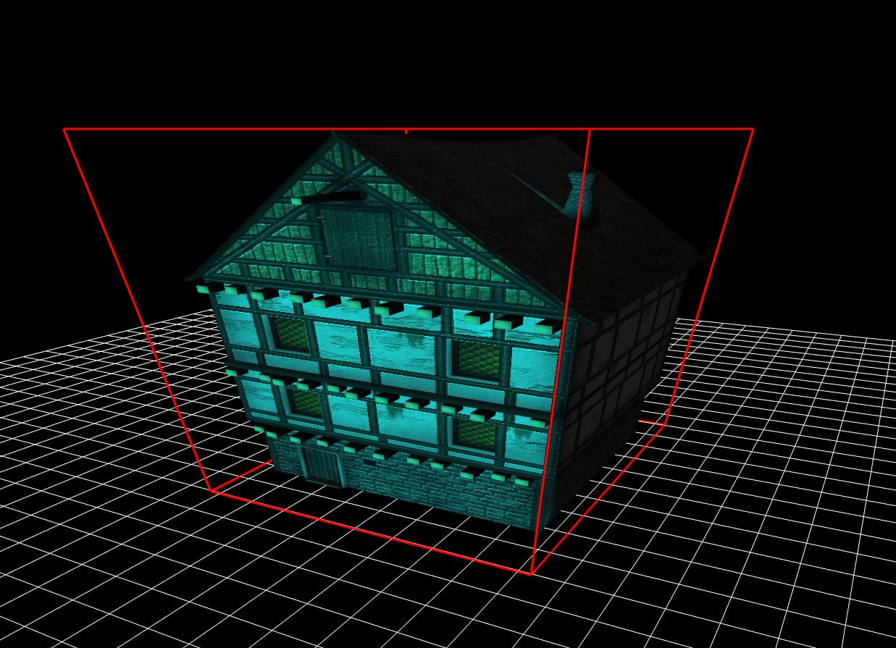

# BGL 3D Model Viewer

[](https://github.com/bkuolt/bgl-3D-model-viewer/actions/workflows/test.yml)



A modern C++23 and OpenGL 3D Model Viewer built with Qt 6, Assimp, GLM, and GLEW.

## Core Features

- **Mesh Loading & Rendering**: Seamless support for loading standard 3D assets (OBJ, PLY, FBX) via Assimp.
- **Material & Texture Mapping**: Multi-material rendering with diffuse map support and material parameter uniforms.
- **Reference Grid & Wireframe Overlay**: Dynamic reference grid and axis-aligned bounding box (AABB) visualization.
- **Orbital ArcBall Camera**: Intuitive camera rotation and smooth distance zooming controls.
- **Clean Architecture**: Encapsulated within the `bgl` namespace adhering to standard modern C++ design patterns.

## Technical Architecture & Dependencies

- **Language Standard**: C++23 (`-std=c++23`)
- **Graphics API**: OpenGL 3.3 Core Profile / GLSL 3.30
- **Package Management**: Conan 2.x
- **Build Automation**: Taskfile (`task`) & CMake 3.20+
- **GUI Framework**: Qt 6 (`Qt6::Widgets`, `Qt6::OpenGLWidgets`)
- **3D Asset Import**: Assimp
- **Math Library**: GLM (OpenGL Mathematics)
- **OpenGL Extension Wrangler**: GLEW

## Prerequisites

- C++23 compliant compiler (GCC 13+, Clang 16+, MSVC 2022+)
- CMake 3.20+
- Conan 2.x
- Task (`go-task`)

## Build & Usage Instructions

### Quick Start with Taskfile

```bash
# Install dependencies, configure CMake, and compile the application
task build

# Execute the 3D model viewer with the default sample model
task run

# Format source code using clang-format
task format

# Clean build directory
task clean
```

### Manual Build with CMake & Conan 2.x

```bash
# 1. Install dependencies via Conan 2.x
conan install . --output-folder=build --build=missing -s build_type=Release

# 2. Configure project via CMake using the generated Conan toolchain
cmake -B build -DCMAKE_BUILD_TYPE=Release -DCMAKE_TOOLCHAIN_FILE=build/conan_toolchain.cmake

# 3. Build executable
cmake --build build --config Release -j

# 4. Run application
./build/bgl_demo src/assets/models/housemedieval.obj
```

## Interactive Controls

| Control | Description |
|---|---|
| **Arrow Keys** | Orbit camera around target focus point |
| **Mouse Wheel** | Zoom camera distance in / out |
| **ESC** | Quit application |